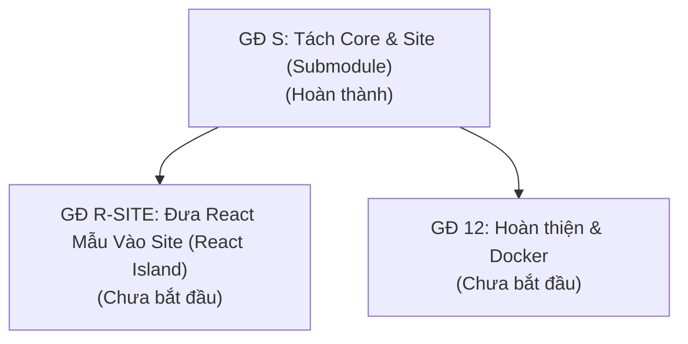

# Lộ trình & Bảng Tổng hợp Tiến độ (Project Phases Roadmap)
> File: `docs/phases/README.md`  
> Nguồn sự thật duy nhất (Single Source of Truth) về trạng thái thực thi của các giai đoạn phát triển.

---

## 1. Sơ đồ Phụ thuộc Giai đoạn (Dependency Graph)

---

## 2. Bảng Tổng hợp Tiến độ Các Giai đoạn

| GĐ | Tên giai đoạn | Trạng thái | Phụ thuộc | File chi tiết | Ngày bắt đầu | Ngày hoàn thành | Ghi chú |
| :---: | :--- | :--- :---: | :---: | :--- | :---: | :---: | :--- |
| **0 → 11** | Toàn bộ 18 giai đoạn nền tảng Treecraft Core (GĐ 0 đến GĐ 11, R1, R2, B1, 11-Y2, 11-Y3, L1, F1-F3, K1, E1) | **Hoàn thành** | - | Xem chi tiết trong `core/docs/phases/` | 2026-11-03 | 2026-11-17 | Xong Core CMS Engine, Tree Architecture, Presentation EJS, ACL, Workflow & Publish |
| **S** | Tách Core & Site, Lệnh init Một Bước | **Hoàn thành** | 11-Y3, R2 | [`phase-S-core-site-split.md`](../../core/docs/phases/phase-S-core-site-split.md) | 2026-11-17 | 2026-11-17 | Core bất biến dưới dạng Git Submodule, site/ tách rời, DEC-056 |
| **S-Parity** | Bảo toàn Đồng nhất Cây Nội dung & Snapshot Starter | **Hoàn thành** | S | [`phase-S-tree-parity.md`](../../core/docs/phases/phase-S-tree-parity.md) | 2026-11-17 | 2026-11-17 | Parity 100% cây nội dung sau init, starter YAML |
| **R-SITE** | Đưa Dự Án React Mẫu Vào Site (React Island) | **Hoàn thành** | S | [`phase-R-SITE-react.md`](./phase-R-SITE-react.md) | 2026-11-19 | 2026-11-19 | Bóc tách React mẫu MaoShop vào `site/react`, EJS SSR + React Island mount, manifest bundle, một lệnh `npm run dev` |
| **12** | Hoàn thiện, Bảo mật, E2E SSR Test & Docker | **Chưa bắt đầu** | S, R-SITE | [`phase-12-hardening.md`](../../core/docs/phases/phase-12-hardening.md) | - | - | E2E test luồng Page -> Template -> Presentation -> Publish -> Site Renderer EJS |

---

## 3. Quy tắc Đồng bộ Trạng thái
- Khi một giai đoạn hoàn thành, trạng thái phải được cập nhật đồng thời ở:
  1. Bảng trên (`docs/phases/README.md`)
  2. Front-matter của file phase tương ứng (`status: Hoàn thành` trong `docs/phases/phase-nn-*.md`)
